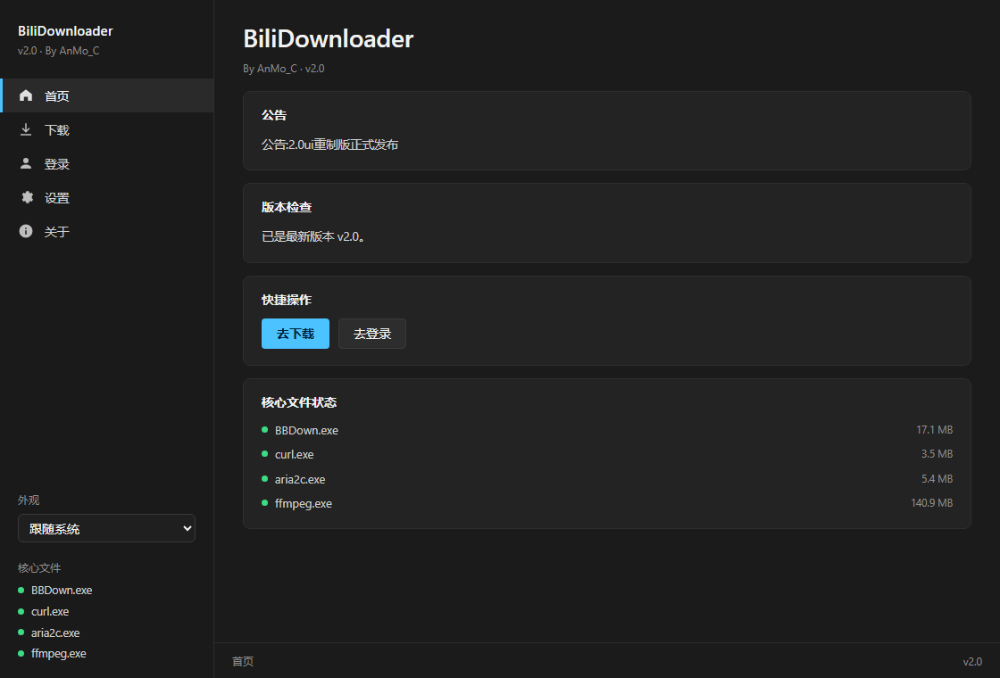
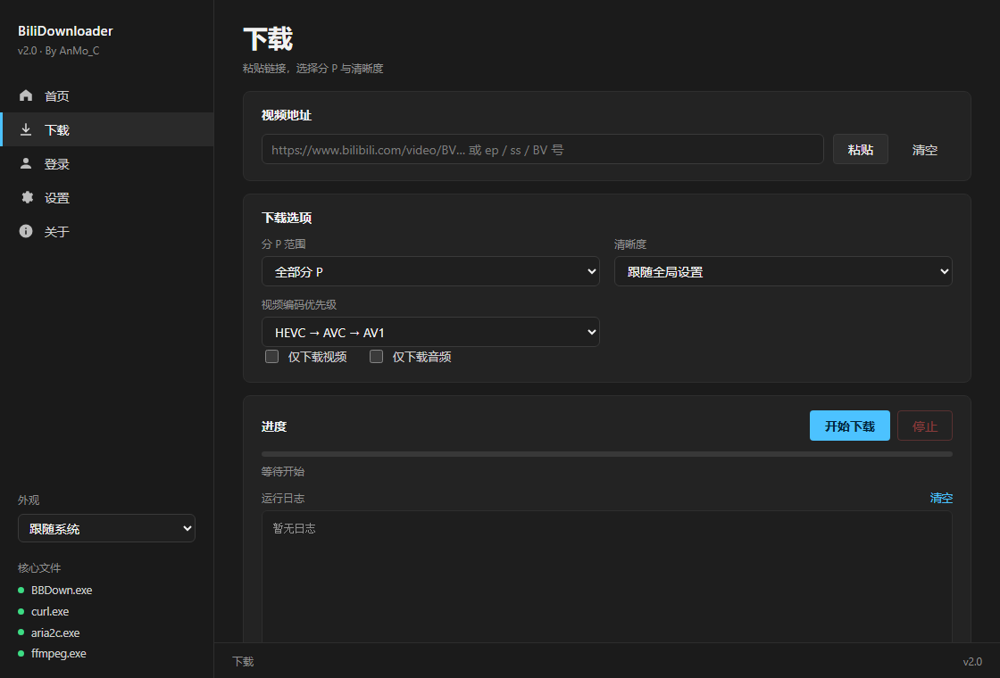
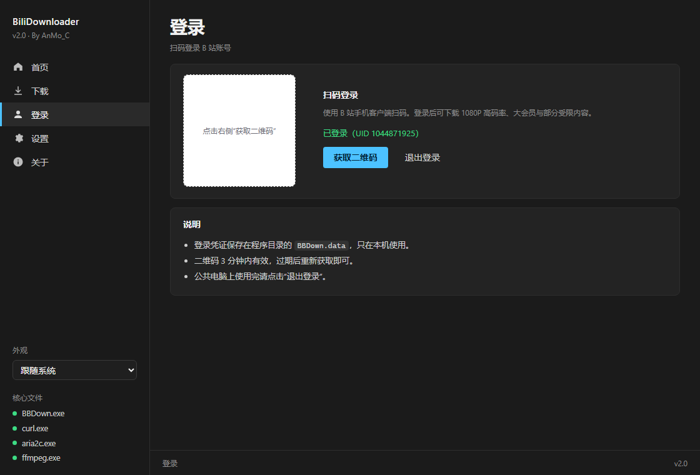
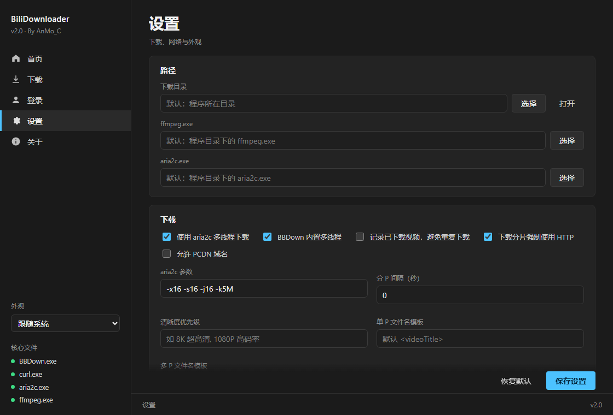

# BiliDownloader


Windows 下的 B 站视频下载器：本地 Web UI（WinUI 3 Fluent 风格），下载内核基于 [BBDown](https://github.com/nilaoda/BBDown)，由系统 Edge 的 App 模式窗口或默认浏览器承载界面。

- 无需安装 Python（安装包自带运行时）
- 无广告、无账号上传、不上传使用数据
- 仅监听 `127.0.0.1` 随机端口

## 功能

- 视频 / 番剧 / 分 P 下载，支持 8K、4K、1080P 高码率等清晰度
- 扫码登录 B 站账号，自动显示会员等级与可用清晰度
- 支持 Cookie / Access Token、TV / APP / 国际版接口
- aria2c 多线程或 BBDown 内置下载，可跳过混流、字幕、封面、弹幕
- 下载完成后自动归集到 `Downloads` 并打开目录
- 内置窗口（Edge App / WebView）与默认浏览器两种界面方式，可在设置中切换
- 首次启动引导选择窗口方式；缺少 Edge / WebView2 时提示下载或改用浏览器
- 自动检查更新与公告（可配置强制更新）
- 内置开发者调试控制台，可查看 BBDown 原始日志并发送参数
- 深色 / 浅色 / 跟随系统，多种主题色，可收起侧边栏

## 界面截图

| 首页 | 下载 |
| --- | --- |
|  |  |

| 登录 | 设置 |
| --- | --- |
|  |  |

## 下载与安装

从 [Releases](https://github.com/AnMo2077/bbdown_gui/releases) 下载 `BiliDownloader-Setup-2.0.exe`。

- 默认安装到 `%LOCALAPPDATA%\Programs\BiliDownloader`（当前用户，无需管理员）
- 安装时可自行修改安装路径
- 创建桌面与开始菜单快捷方式，并写入当前用户的卸载项
- 不安装服务、不写自启动项

卸载：Windows 设置 → 应用 → BiliDownloader，或运行安装目录下的 `Uninstall.exe`。

> 卸载会删除安装目录。若使用默认下载目录 `安装目录\Downloads`，请先把视频移出该目录。

安装包未做数字签名，Windows SmartScreen 可能提示“未知发布者”；可核对 Release 中的 SHA256。

## 首次启动

1. 选择界面方式：**内置窗口（WebView / Edge）** 或 **默认浏览器**
2. 选择会写入配置，之后可在 设置 → 外观 → 界面窗口 修改（下次启动生效）
3. 若选择内置窗口但未检测到 Edge / WebView2，会弹窗提供：
   - 下载 WebView2
   - 使用默认浏览器
   - 退出

## 使用

1. 打开「登录」，用 B 站手机客户端扫码
2. 打开「下载」，粘贴视频 / 番剧地址
3. 选择分 P 范围与清晰度（可跟随全局设置）
4. 点击「开始下载」
5. 完成后点击「打开文件所在位置」

默认下载目录为 `安装目录\Downloads`，可在 设置 → 路径 中修改下载目录与归集目录。

## 设置

- **路径**：下载目录、ffmpeg / aria2c 路径、下载完成后移动到
- **下载**：aria2c、多线程、清晰度优先级、文件名模板、跳过混流/字幕/封面/弹幕
- **接口与网络**：TV / APP / 国际版接口、BiliPlus、UA、UPOS Host
- **凭证**：Cookie、Access Token
- **日志**：登录检测日志等级（简洁 / 详细）
- **开发者**：打开调试控制台
- **外观**：主题色、界面窗口、侧边栏

## 从源码运行

要求：Windows 10/11、Python 3.10+。

```bat
py gui.py            :: 内置窗口
py gui.py --browser  :: 默认浏览器
py gui.py --serve    :: 仅启动本地服务
```

运行源码时仍需把 BBDown / ffmpeg / aria2c / curl 放在项目根目录，可执行：

```powershell
pwsh -File scripts/fetch-binaries.ps1
```

## 构建安装包

```powershell
# 1. 获取第三方二进制（BBDown / aria2 / curl 固定版本，ffmpeg 官方 shared 构建）
pwsh -File scripts/fetch-binaries.ps1

# 2. 安装构建依赖
py -m pip install pyinstaller pillow

# 3. 构建
py build_installer.py
```

产物：`dist\BiliDownloader-Setup-2.0.exe`

构建流程：PyInstaller 打包应用（onedir）→ 复制 BBDown / ffmpeg / aria2c / curl 与 DLL → 打包卸载器 → 压缩 payload → 生成单文件安装程序。

> 仓库不提交 exe/dll，CI 与本地构建都通过 `scripts/fetch-binaries.ps1` 下载所需版本，避免把二进制和本地配置带进仓库。

## GitHub Actions 自动构建

工作流：`.github/workflows/build.yml`

- **push / pull_request**：编译检查 + 单元测试
- **workflow_dispatch**：构建安装包并上传 Artifact；`release_tag` 默认 `v2.0`，填写后会创建/更新对应 Release
- **推送 `v*` 标签**：构建安装包、上传 Artifact，并自动创建 GitHub Release

第三方二进制会缓存到 `vendor/`，缓存键包含脚本哈希。构建前会校验版本与发布者，安装包生成后输出 SHA256。

## 目录结构

```
gui.py                     启动器（本地服务 + 窗口宿主）
app/                       后端（HTTP API、BBDown 封装、扫码登录、配置）
app/webui/                 前端（HTML / CSS / JS、图标、manifest）
installer/installer.py     安装程序
installer/uninstall.py     卸载程序
build_installer.py         一键构建安装包
scripts/fetch-binaries.ps1 获取固定版本第三方二进制
tests/test_app.py          回归测试
docs/screenshots/          README 截图
```

## 数据与配置文件

安装版（安装目录下）：

- `gui_config.json`：设置
- `download_history.json`：下载历史
- `BBDown.data`：登录凭证（Cookie）
- `BiliDownloader.log`：启动与错误日志
- `Downloads/`：默认下载目录

源码版：项目根目录。

所有数据仅保存在本机；服务只监听 `127.0.0.1`，不会上传账号或下载记录。

## 安全说明

- 应用不包含遥测、后台上传、计划任务或注册表自启动
- 网络请求仅用于 B 站接口、公告/版本检查与 GitHub 更新
- 第三方二进制来自各自官方发布页：
  - BBDown 1.6.3（nilaoda/BBDown）
  - FFmpeg shared build（gyan.dev）
  - aria2 1.37.0（aria2/aria2）
  - curl for Windows（curl.se）
- 应用内「关于 → 开放源代码许可」列出了组件与许可证

## 免责声明

本项目仅用于学习与个人备份，请只下载你有权保存的内容，遵守 B 站用户协议与当地法律。项目与哔哩哔哩无关联。第三方组件的版权与许可证归各自作者所有。

## 致谢

- [BBDown](https://github.com/nilaoda/BBDown)
- [FFmpeg](https://ffmpeg.org/)
- [aria2](https://aria2.github.io/)
- [curl](https://curl.se/)
- Microsoft Edge / WebView2
